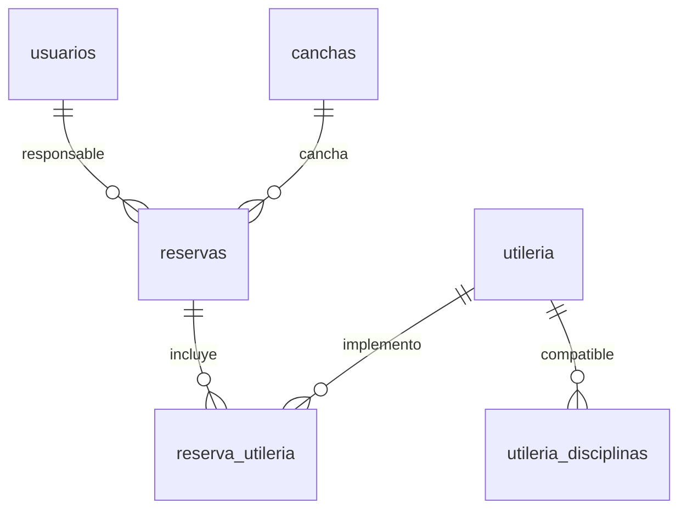

# Fase 2 — Modelo de datos y persistencia MySQL

## 1. Alcance y diagnóstico

Se completó exclusivamente la fase 2 sobre la estructura de la fase 1.
Se conservaron Java 25, Spring Boot 4.1.2, el POM y todas las dependencias existentes.
No se añadieron librerías ni se implementaron endpoints.

Antes de editar se revisaron modelos, entidades, puertos, servicios, repositorios, mappers,
adaptadores, configuraciones y pruebas existentes. Las 12 pruebas de la fase 1 pasaron.
La base sistema_canchas_deportivas ya existía en MySQL 8.0.46, pero no tenía tablas.
El primer intento de conexión desde el entorno restringido fue bloqueado por permisos de socket;
al ejecutar con el permiso correspondiente se confirmó que MySQL80 estaba activo.

El perfil mysql tenía valores predeterminados root/root. Ahora esos valores se aplican
exclusivamente cuando está activo el perfil local. La implementación de UsuarioInicial,
UsuarioService, PasswordAdapter y BCrypt se conserva.

## 2. Archivos creados y modificados

Las rutas Java siguientes parten de src/main/java/org/example/sistema_canchas_deportivas.

### Nuevos archivos principales

| Archivo | Responsabilidad |
|---|---|
| domain/models/TipoImplemento.java | BALON, CHALECO, RAQUETA y TUBO_PELOTAS. |
| application/ports/in/DatosInicialesIn.java | Caso de uso de inicialización del catálogo. |
| application/services/DatosInicialesService.java | Carga transaccional e idempotente usando exclusivamente puertos OUT. |
| infraestructure/config/DatosIniciales.java | CommandLineRunner que invoca el caso de uso y registra su finalización. |
| infraestructure/mappers/ReservaUtileriaMapper.java | Conversión del detalle de utilería, sin ciclos en los modelos de dominio. |

### Archivos principales modificados

| Paquete | Archivos |
|---|---|
| domain/models | Reserva.java, Utileria.java |
| application/ports/out | UsuarioOut.java, CanchaOut.java, HorarioAtencionOut.java, UtileriaOut.java, ReservaOut.java |
| infraestructure/entities | UsuarioEntity.java, CanchaEntity.java, HorarioAtencionEntity.java, UtileriaEntity.java, ReservaEntity.java, ReservaUtileriaEntity.java |
| infraestructure/repositories | UsuarioRepository.java, CanchaRepository.java, HorarioAtencionRepository.java, UtileriaRepository.java, ReservaRepository.java |
| infraestructure/adapters | UsuarioAdapter.java, CanchaAdapter.java, HorarioAtencionAdapter.java, UtileriaAdapter.java, ReservaAdapter.java |
| infraestructure/mappers | CanchaMapper.java, HorarioAtencionMapper.java, UtileriaMapper.java, ReservaMapper.java |
| src/main/resources | application.yaml, application-mysql.yaml |

### Pruebas y documentación

Se crearon:

- src/test/java/org/example/sistema_canchas_deportivas/application/services/DatosInicialesServiceTest.java
- src/test/java/org/example/sistema_canchas_deportivas/infraestructure/mappers/PersistenciaMappersTest.java
- src/test/java/org/example/sistema_canchas_deportivas/infraestructure/persistence/PersistenciaMysqlTest.java
- docs/verificar_fase_2.sql
- FASE_2.md

Se adaptó SistemaCanchasDeportivasApplicationTests.java para sustituir los nuevos repositorios
y el inicializador de catálogos en la prueba que funciona sin base de datos.
Las pruebas MySQL usan todos los adaptadores, repositorios y mappers reales.

## 3. Arquitectura

El dominio conserva clases Java sin dependencias de JPA o Spring.
Los modelos Reserva y Utileria incluyen colecciones inmutables de detalles y disciplinas,
respectivamente. Los modelos de dominio usan IDs para sus referencias y evitan grafos cíclicos.

La aplicación accede a la persistencia mediante interfaces OUT:

```text
DatosIniciales (CommandLineRunner)
  → DatosInicialesIn
  → DatosInicialesService (@Transactional)
  → CanchaOut / HorarioAtencionOut / UtileriaOut
  → Adaptadores → Mappers → Repositorios Spring Data → MySQL

Reserva (dominio) → ReservaOut → ReservaAdapter
  → ReservaMapper + ReservaUtileriaMapper
  → ReservaRepository → MySQL
```

Los adaptadores convierten los resultados dentro de transacciones para poder leer las relaciones
LAZY con open-in-view=false. ReservaAdapter obtiene referencias a las filas de usuario, cancha
y utilería; no las crea por cascada. El detalle se persiste junto con la reserva.

No hay un caso de uso de reserva expuesto todavía: guardar una reserva por el puerto de persistencia
no implica validar disponibilidad, autenticación o existencias. Eso se implementará en las fases 5 y 6.

## 4. Modelo y relaciones



| Tabla | Contenido y restricciones |
|---|---|
| usuarios | ID autoincremental, username único, password_hash, rol y activo. Se agrega la relación inversa de reservas. |
| canchas | ID, nombre único, tipo, superficie nullable y activa. |
| horarios_atencion | ID, día único, apertura y cierre; apertura debe ser anterior al cierre. Configuración del complejo. |
| utileria | ID, nombre único, tipo, existencias físicas no negativas y activa. |
| utileria_disciplinas | FK a utileria y disciplina; pareja única, ambos valores obligatorios. |
| reservas | ID, FK al responsable y cancha, disciplina, fecha, hora_inicio, duracion_horas, estado y fecha_creacion. Duración limitada a 1 o 2 en el esquema. |
| reserva_utileria | ID, FK a reserva y utilería, cantidad positiva y pareja reserva/utilería única. |

Las cuatro relaciones 1:N solicitadas son navegables en JPA en ambas direcciones.
Las relaciones N:1 se cargan con LAZY. No hay cascadas REMOVE ni borrado de huérfanos.
Los puertos OUT no ofrecen operaciones de eliminación.

Los índices de reservas agrupan cancha o responsable con fecha, estado y hora de inicio.
El detalle tiene índice por utileria_id y unicidad por reserva_id/utileria_id.
Se utilizan enums de Java y columnas de fecha/hora nativas.

### Fecha y hora final

El dominio conserva inicio como LocalDateTime y ofrece fecha, hora de inicio, fin y hora de fin.
En MySQL se persisten fecha, hora_inicio y duracion_horas.
Fin se calcula como inicio + duración, sin almacenar valores redundantes que puedan contradecirse.
fecha_creacion se recibe explícitamente y se persiste; no se toma la zona horaria del servidor
desde un callback JPA. En la fase de reservas el caso de uso deberá usar app.timezone.

### Integridad frente a reglas de negocio

En esta fase hay restricciones estructurales de base de datos: claves, unicidad, intervalos de atención,
duración de 1–2 horas, cantidades positivas y existencias no negativas.
Las reglas completas de reservas, incluida la ausencia de superposiciones y el máximo diario,
siguen pendientes. No se confunde una escritura directa de persistencia con una reserva válida de negocio.

## 5. Datos iniciales

| Canchas físicas | Cantidad | Superficie |
|---|---:|---|
| Fútbol 11 | 2 | NATURAL |
| Fútbol 6 | 5 | SINTETICA |
| Básquet | 4 | null |
| Vóley/Ecuavóley | 4 | null |
| Tenis | 2 | null |

Los nombres tienen la forma Fútbol 11 - Cancha 1, etc.
Se comprueba cada nombre antes de insertar, cada día antes de cargar el horario y cada nombre
de implemento antes de añadirlo. Si existe, se conserva su configuración.
Las restricciones únicas protegen también frente a duplicados en MySQL.

Se cargan lunes–jueves 08:00–16:00 y viernes–domingo 08:00–22:00.

| Implemento | Tipo | Disciplinas iniciales | Existencias |
|---|---|---|---:|
| Balón fútbol número 5 | BALON | FUTBOL_11 | 0 |
| Balón fútbol número 4 | BALON | FUTBOL_6 | 0 |
| Balón básquet número 7 | BALON | BASQUET | 0 |
| Balón Mikasa V200W | BALON | VOLEY | 0 |
| Balón Mikasa FT-5 | BALON | ECUAVOLEY | 0 |
| Chalecos | CHALECO | FUTBOL_11, FUTBOL_6 | 0 |
| Raquetas de tenis | RAQUETA | TENIS | 0 |
| Tubos de 3 pelotas de tenis | TUBO_PELOTAS | TENIS | 0 |

Las existencias no se restablecen en cada arranque. Los tubos son unidades de tres pelotas,
sin inventar unidades físicas disponibles. Tampoco se crean reservas como datos iniciales.

El administrador se crea mediante el flujo anterior, únicamente si no existe el username admin.
No se cambia su rol ni contraseña al reiniciar. En esta base inicialmente vacía, la inicialización
creó la primera fila admin y almacenó su hash BCrypt.

La idempotencia se basa en nombres y días. Si se renombra un elemento inicial, el nombre original
se considera ausente en el siguiente arranque; antes de ofrecer renombrado en fases posteriores
conviene adoptar un código estable para las semillas. Los registros adicionales ajenos al catálogo
no se eliminan para forzar un contador de 17.
En arranques simultáneos sobre una base vacía, una instancia podría recibir un conflicto de unicidad
y necesitar reinicio; no se implementó coordinación distribuida del inicializador.

## 6. Configuración y ejecución

- Perfil local: activa mysql, permite DB_USERNAME/DB_PASSWORD con valores locales root/root, ddl-auto=update y show-sql=true.
- Perfil mysql sin local: exige DB_USERNAME y DB_PASSWORD, ddl-auto=validate y show-sql=false.
- Fuera de local, el esquema debe administrarse con migraciones controladas. Esta fase no añade una herramienta de migración.
- La clave inicial del administrador continúa usando ADMIN_INITIAL_PASSWORD; admin123 solo es un valor de referencia local.
- DB_URL permite sustituir la dirección; por defecto apunta a la base solicitada en localhost:3306 y permite crearla si no existe.
- Zona horaria configurada: America/Guayaquil.

Arranque local:

```powershell
.\mvnw.cmd spring-boot:run '-Dspring-boot.run.profiles=local'
```

Para usar credenciales distintas, define DB_USERNAME y DB_PASSWORD en la terminal.
No es necesario recrear la base. No se usa create, create-drop, DELETE ni TRUNCATE para inicializar.

Compilación y pruebas sin requerir MySQL:

```powershell
.\mvnw.cmd clean compile
.\mvnw.cmd test
```

Para habilitar las diez pruebas de integración contra la base local:

```powershell
$env:RUN_MYSQL_TESTS = 'true'
.\mvnw.cmd test
Remove-Item Env:RUN_MYSQL_TESTS
```

El contexto inicia los catálogos si faltan. Las escrituras de cada método de integración
están dentro de una transacción que se revierte al finalizar, sin eliminar datos existentes.
Los contadores autoincrementales pueden tener saltos debido a estas transacciones.

Estas pruebas esperan el catálogo inicial de 17 canchas, siete horarios y ocho implementos.
No las ejecutes contra producción; se habilitan explícitamente para la base de desarrollo.

## 7. Verificación realizada

- Compilación con Java 25: BUILD SUCCESS, 85 archivos principales.
- Suite sin habilitar MySQL: 18 pruebas ejecutadas correctamente y 10 de integración omitidas.
- Suite con RUN_MYSQL_TESTS=true: 28 pruebas ejecutadas, 0 fallos, 0 errores, 0 omitidas.
- Conexión real: MySQL 8.0.46, base sistema_canchas_deportivas.
- Tablas y restricciones verificadas mediante information_schema.
- Estado persistido: 1 usuario, 17 canchas, 7 horarios, 8 implementos y 9 compatibilidades.
- Después de las pruebas: 0 reservas y 0 detalles de reserva persistidos.
- Inicialización repetida: conserva IDs, catálogo y hash del administrador.
- Cambios transaccionales de existencias, estado de cancha y horarios: no se sobrescriben al ejecutar nuevamente el inicializador.

En el entorno restringido se usaron estos comandos equivalentes para aprovechar la caché
existente y usar bloqueos Maven en memoria:

```powershell
.\mvnw.cmd -o '-Daether.syncContext.named.factory=rwlock-local' clean compile
.\mvnw.cmd -o '-Daether.syncContext.named.factory=rwlock-local' test
$env:RUN_MYSQL_TESTS = 'true'
.\mvnw.cmd -o '-Daether.syncContext.named.factory=rwlock-local' test
```

La ejecución MySQL requirió acceso al socket local fuera del entorno restringido.
El informe Maven de la última suite está en target/fase2-pruebas-mysql.log y los resultados
por clase en target/surefire-reports.

Los avisos de violaciones de claves y CHECK del log de integración corresponden a pruebas
que provocan deliberadamente esos rechazos. No son fallos de la suite.
Lombok emite un aviso existente sobre sun.misc.Unsafe.
Las restricciones nuevas usan CheckConstraint de Jakarta Persistence 3.2.

El arranque real se verificó con:

```powershell
.\mvnw.cmd spring-boot:run '-Dspring-boot.run.profiles=local' '-Dspring-boot.run.arguments=--server.port=0 --spring.jpa.show-sql=false'
```

El intento inicial sin conexión no pudo resolver dependencias del plugin de ejecución aún no
descargadas. Se repitió con acceso a Maven Central y el servidor arrancó correctamente,
sin cambiar el POM. Tomcat utilizó el puerto temporal 53171 y la conexión a MySQL se estableció.
GET /api/canchas devolvió 403, como corresponde a la cadena cerrada de esta fase.

Se comparó una huella del hash junto con ID, username, rol y estado antes y después del arranque:
el administrador permaneció idéntico. Los contadores siguieron en 1 usuario, 17 canchas,
7 horarios, 8 implementos y 0 reservas; todas las existencias permanecieron en cero.
Después de comprobarlo se detuvo el servidor temporal. El log está en target/fase2-arranque.log.

## 8. Cómo comprobar los resultados

Ejecuta docs/verificar_fase_2.sql en MySQL Workbench o mediante el cliente mysql.
El script solo consulta datos, cantidades, compatibilidades, claves e índices y comprueba
el formato BCrypt sin imprimir el hash.

No hay endpoints ni ejemplos JSON nuevos en esta fase.
La configuración de seguridad sigue denegando las rutas hasta implementar autenticación y permisos.
Los casos de persistencia se verifican mediante las pruebas y las consultas SQL indicadas.

## 9. Pendientes

- Fase 3: registro, login, JWT, roles, CORS y respuestas 401/403.
- Fase 4: administración de canchas/horarios y consulta de disponibilidad.
- Fase 5: creación, consulta y cancelación de reservas con reglas y bloqueos transaccionales.
- Fase 6: asignación opcional de utilería y disponibilidad temporal.
- Fase 7: revisión completa, pruebas adicionales y documentación general.

Se mantiene como interpretación acordada el máximo de dos horas acumuladas por responsable y día,
excluyendo canceladas. También deberá impedirse la superposición del propio responsable aunque
sean canchas diferentes. Ambas validaciones se implementarán en la fase 5.

## 10. Próximo paso

Fase 3 — Autenticación, JWT y seguridad, únicamente cuando sea autorizada.

Referencia técnica consultada: [transacciones en Spring Data JPA](https://docs.spring.io/spring-data/jpa/reference/jpa/transactions.html).

