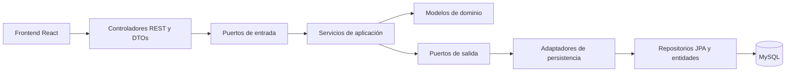
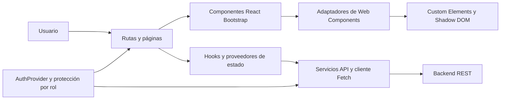

# Sistema de reservas de canchas deportivas

Aplicación web para consultar canchas y disponibilidad, realizar reservas y solicitar implementos deportivos. Incluye un panel administrativo para gestionar canchas, horarios, utilería, clientes, usuarios, reservas y los implementos asociados a cada reserva.

El proyecto académico integra un **backend REST con Java y Spring Boot** y un **frontend con React, JavaScript, React Bootstrap y Web Components nativos**. Aplica separación de responsabilidades, autenticación por roles, validaciones de negocio y una interfaz adaptable a móviles y escritorio.

**Este repositorio contiene el backend.** El frontend está implementado en el proyecto independiente `sistema_canchas_frontend`. Para ejecutar el sistema completo se necesitan ambos proyectos y MySQL.

## Contenido

- [Funcionalidades y roles](#funcionalidades-y-roles)
- [Tecnologías utilizadas](#tecnologías-utilizadas)
- [Estructura de los proyectos](#estructura-de-los-proyectos)
- [Arquitectura del backend](#arquitectura-del-backend)
- [Arquitectura del frontend](#arquitectura-del-frontend)
- [Modelo y reglas de negocio](#modelo-y-reglas-de-negocio)
- [Instalación y ejecución local](#instalación-y-ejecución-local)
- [API REST](#api-rest)
- [Pruebas y compilación](#pruebas-y-compilación)
- [Solución de problemas](#solución-de-problemas)
- [Trabajo colaborativo](#trabajo-colaborativo)
- [Documentación complementaria](#documentación-complementaria)
- [Alcance y licencia](#alcance-y-licencia)

## Funcionalidades y roles

| Acceso | Funcionalidades |
|---|---|
| Visitante | Consultar catálogo, detalles e imágenes de referencia; buscar disponibilidad, registrarse e iniciar sesión. |
| `CLIENTE` | Crear reservas propias, agregar utilería opcional, consultar su historial y cancelar reservas antes de su inicio. |
| `ADMIN` | Crear, consultar, editar y eliminar registros de los siete recursos; gestionar cuentas, perfiles, horarios, existencias y reservas. |

Las cuentas nuevas siempre se crean con rol `CLIENTE`. El registro solicita usuario, contraseña, cédula, nombres, apellidos, correo y teléfono. Las credenciales pertenecen a `Usuario`; los datos personales, a `Cliente`.

El panel administrativo utiliza **tablas y botones de acción** con pantallas `Index`, `Details`, `Create`, `Edit` y `Delete`. La eliminación requiere confirmación y las relaciones entre registros pueden impedirla. La cuenta administrativa inicial está protegida frente a eliminación, desactivación y cambio de rol.

La interfaz incorpora errores junto al campo, estados de carga y ausencia de datos, navegación por teclado, tablas con búsqueda y paginación local y diseño responsivo. Las imágenes por disciplina son referencias generadas con IA, no fotografías de instalaciones reales.

## Tecnologías utilizadas

Las versiones corresponden a la configuración del proyecto, no a una recomendación de instalar siempre la última disponible.

| Área | Tecnologías | Uso |
|---|---|---|
| Backend | Java 25, Spring Boot 4.1.2, Maven Wrapper | Aplicación y dependencias. |
| API y validación | Spring Web MVC, Jakarta Validation | Endpoints REST, DTOs y validación. |
| Persistencia | Spring Data JPA, Hibernate, MySQL 8, MySQL Connector/J | Repositorios, entidades y transacciones. |
| Seguridad | Spring Security, JJWT 0.12.6, BCrypt | Autenticación, permisos y hash de contraseñas. |
| Utilidades Java | Lombok | Reducción de código repetitivo. |
| Frontend | React 19.3, JavaScript/JSX, React Router 8.5 | Interfaz SPA, componentes y navegación. |
| Diseño | React Bootstrap 2.10, Bootstrap 5.3, CSS | Formularios, tablas, diálogos y diseño responsivo. |
| Componentes web | Custom Elements, Shadow DOM, CustomEvent | Elementos nativos integrados con React. |
| Entorno frontend | Node.js 24, npm, Vite 8.3 | Instalación, desarrollo y compilación. |
| Pruebas | JUnit, Mockito, Spring Test; Vitest, Testing Library, Playwright | Pruebas unitarias, HTTP, integración y navegador. |
| Colaboración y calidad | Git, GitHub, ESLint, IntelliJ IDEA | Control de versiones, revisión y desarrollo. |

Las dependencias Java están en [pom.xml](pom.xml). Las del frontend se definen en su `package.json` y se fijan mediante `package-lock.json`; se instalan con `npm ci`.

## Estructura de los proyectos

Se recomienda descargar ambos proyectos dentro de una misma carpeta de trabajo:

```text
proyecto-grupal/
├── sistema_canchas_deportivas/       # Backend: este repositorio
│   ├── .mvn/wrapper/
│   ├── docs/                        # Contratos, guías, peticiones HTTP y SQL
│   ├── src/main/java/org/example/sistema_canchas_deportivas/
│   │   ├── domain/
│   │   │   ├── models/
│   │   │   └── exception/
│   │   ├── application/
│   │   │   ├── ports/in/
│   │   │   ├── ports/out/
│   │   │   └── services/
│   │   └── infraestructure/
│   │       ├── controllers/dtos/
│   │       ├── adapters/
│   │       ├── repositories/
│   │       ├── entities/
│   │       ├── mappers/
│   │       ├── securities/
│   │       ├── exceptions/
│   │       ├── auditoria/
│   │       ├── validation/
│   │       └── config/
│   ├── src/main/resources/          # Configuración Spring Boot
│   ├── src/test/                    # Pruebas Java
│   ├── .env.example
│   ├── pom.xml
│   ├── mvnw / mvnw.cmd
│   └── README.md
└── sistema_canchas_frontend/         # Proyecto independiente
    ├── src/
    │   ├── api/                     # Cliente HTTP y servicios de la API
    │   ├── app/                     # Estructura visual
    │   ├── auth/                    # Sesión y protección de rutas
    │   ├── assets/imagenes/         # Referencias por disciplina
    │   ├── components/              # Componentes reutilizables
    │   ├── hooks/                   # Consulta y estado de recursos
    │   ├── pages/                   # Páginas públicas, CLIENTE y ADMIN
    │   │   └── admin/crud/          # Index, Details, Create, Edit, Delete
    │   ├── reservas/                # Coordinación de operaciones
    │   ├── styles/
    │   ├── utils/                   # Fechas y validaciones
    │   ├── web-components/          # Custom Elements nativos
    │   └── test/
    ├── e2e/                        # Pruebas de navegador
    ├── .env.example
    ├── package.json
    ├── package-lock.json
    └── vite.config.js
```

Los nombres `infraestructure` y `securities` se conservan por coherencia con la estructura utilizada en clase.

## Arquitectura del backend

Se aplica **arquitectura hexagonal, organizada en dominio, aplicación e infraestructura**.

| Capa | Responsabilidad |
|---|---|
| Dominio | Modelos y reglas de negocio, independientes de HTTP y JPA. |
| Aplicación | Casos de uso mediante servicios, puertos de entrada `in` y contratos de salida `out`. |
| Infraestructura | Controladores, DTOs, adaptadores, repositorios JPA, entidades, mappers, seguridad y configuración. |



Los mappers convierten modelos y entidades; los DTOs delimitan los datos de la API. La aplicación no tiene una carpeta `models` propia y no utiliza aspectos personalizados. Los campos `creado` y `modificado` son `LocalDateTime` y los administra la persistencia; no son campos editables del formulario.

### Autenticación y autorización

El login sigue la implementación de clase: `AuthController` utiliza `AuthenticationManager`, `UsuarioDetailsService` y `JWTServices`. No hay puertos específicos de entrada/salida para autenticar. `PasswordOut` abstrae el tratamiento de contraseñas con BCrypt.

Las peticiones protegidas envían `Authorization: Bearer <token>`. `JWTFilter` valida el token y comprueba la cuenta vigente; Spring Security controla los permisos por rol. `LoginInterceptor` registra tiempos del login y no sustituye la autenticación. El backend trabaja sin sesiones HTTP de autenticación.

## Arquitectura del frontend

El frontend es una **SPA basada en componentes**, con separación entre presentación, estado de sesión, operaciones de negocio y comunicación HTTP.



- **Navegación:** React Router organiza rutas públicas, privadas y administrativas mediante `ProtectedRoute` y `RoleRoute`.
- **Sesión:** `AuthProvider` conserva el JWT únicamente en memoria. Recargar la página requiere iniciar sesión nuevamente. Un `401` invalida la sesión; un `403` informa falta de permisos.
- **Comunicación:** `src/api/` centraliza Fetch, cabeceras, errores y contratos de respuesta. Los formularios envían únicamente los campos permitidos.
- **CRUD:** las pantallas reutilizables separan listado, detalle, creación, edición y confirmación de eliminación.
- **Web Components:** `sc-bloque-horario` permite seleccionar un bloque mediante el evento `horario-seleccionado`; `sc-estado-reserva` representa el estado de una reserva. Los adaptadores React gestionan propiedades y eventos.
- **Operaciones pendientes:** se evita repetir automáticamente escrituras cuya respuesta no se pudo confirmar, para reducir duplicados.

`src/assets/imagenes/` contiene carpetas para fútbol 11, fútbol 6, básquet, vóley, ecuavóley y tenis. El detalle muestra la referencia correspondiente a la disciplina.

## Modelo y reglas de negocio

| Entidad | Propósito |
|---|---|
| `Usuario` | Credenciales, rol, estado de acceso y vínculo al perfil cuando corresponde. |
| `Cliente` | Cédula, nombres, apellidos, correo y teléfono; también admite registros independientes administrados por ADMIN. |
| `Cancha` | Características, disciplinas admitidas y estado. |
| `HorarioAtencion` | Atención por día de la semana. |
| `Reserva` | Responsable, cancha, disciplina, fecha, intervalo y estado. |
| `Utileria` | Implementos, compatibilidades y existencias físicas. |
| `ReservaUtileria` | Implementos y cantidades solicitadas en una reserva. |

Reglas principales:

- Una cuenta nueva crea su perfil `Cliente` en la misma transacción. Cédula y correo tienen restricciones de unicidad.
- La cédula se conserva como texto de **10 dígitos** y se verifica mediante el algoritmo ecuatoriano. Esto valida su estructura, no la identidad ante el Registro Civil.
- Las reservas duran una o dos horas, comienzan en horas exactas y respetan el horario de atención y la zona `America/Guayaquil`.
- No se permiten cruces para la misma cancha ni para el mismo responsable. El límite es de dos horas confirmadas por cuenta y día.
- Vóley y ecuavóley comparten la misma cancha física cuando corresponde; su ocupación se valida conjuntamente.
- La utilería es opcional. Reservarla no reduce el stock físico: su disponibilidad depende de las cantidades comprometidas simultáneamente.
- La confirmación repite las validaciones dentro de una transacción con bloqueos para controlar solicitudes concurrentes.
- Cancelar conserva el historial y libera disponibilidad. Eliminar es una operación administrativa física, sujeta a relaciones existentes; eliminar una reserva también elimina sus detalles de utilería.

## Instalación y ejecución local

Los comandos están preparados para **Windows PowerShell**, desde la carpeta indicada. En macOS/Linux se utiliza `./mvnw`, `npm` y la sintaxis de variables de entorno de la terminal correspondiente.

### 1. Requisitos

- Git para clonar y trabajar con ramas.
- JDK **25**, con `JAVA_HOME` y `PATH` configurados.
- MySQL **8** iniciado, con soporte de restricciones `CHECK`; verificado localmente con MySQL 8.0.46.
- Node.js **24** y npm; el entorno documentado utiliza Node.js 24.18.0 y npm 11.16.0.
- Conexión a Internet para la primera descarga de dependencias.
- IntelliJ IDEA es opcional; configurar el SDK del backend con Java 25 y el intérprete Node.js del frontend.

No se necesita Maven global: se incluye Maven Wrapper.

```powershell
git --version
java -version
node --version
npm.cmd --version
```

### 2. Clonar o descargar

Sustituir `ORGANIZACION_O_USUARIO` por el propietario real. Si los repositorios tienen otros nombres, copiar sus URL desde el botón **Code** de GitHub.

```powershell
mkdir proyecto-grupal
Set-Location proyecto-grupal
$propietario = 'ORGANIZACION_O_USUARIO'
git clone "https://github.com/$propietario/sistema_canchas_deportivas.git"
git clone "https://github.com/$propietario/sistema_canchas_frontend.git"
Set-Location sistema_canchas_deportivas
```

También se puede usar **Code → Download ZIP** en ambos repositorios y extraerlos con los nombres de la estructura. ZIP no incluye el historial Git; para colaborar se recomienda clonar. Descargar el código no copia la base de datos ni instala las dependencias.

### 3. Preparar MySQL

Para una instalación nueva, crear una base local exclusiva y un usuario con permisos sobre ella. Ejecutar en MySQL Workbench o en otro cliente con una cuenta que permita crear bases y usuarios. Reemplazar la contraseña de ejemplo:

```sql
CREATE DATABASE canchas_equipo_dev
    CHARACTER SET utf8mb4 COLLATE utf8mb4_0900_ai_ci;

CREATE USER 'canchas_dev'@'localhost'
    IDENTIFIED BY 'REEMPLAZAR_POR_UNA_CLAVE_LOCAL';

GRANT ALL PRIVILEGES ON canchas_equipo_dev.*
    TO 'canchas_dev'@'localhost';
```

Si ya se dispone de una base preparada, utilizar su conexión. Los scripts de `docs/sql/` son ajustes parciales para esquemas existentes; **no constituyen un instalador completo**. El script histórico de reinserción de auditoría no es parte de esta instalación.

### 4. Configurar el backend

Desde `sistema_canchas_deportivas`, definir las variables en la misma terminal que iniciará Spring Boot:

```powershell
function Read-LocalSecret([string]$mensaje) {
    $seguro = Read-Host $mensaje -AsSecureString
    return ([pscredential]::new('local', $seguro)).GetNetworkCredential().Password
}

$env:SPRING_PROFILES_ACTIVE = 'local'
$env:DB_URL = 'jdbc:mysql://localhost:3306/canchas_equipo_dev'
$env:DB_USERNAME = 'canchas_dev'
$env:DB_PASSWORD = Read-LocalSecret 'Contraseña del usuario MySQL'
$env:ADMIN_INITIAL_PASSWORD = Read-LocalSecret 'Contraseña inicial de admin (mínimo 12 caracteres)'
$env:CORS_ALLOWED_ORIGINS = 'http://localhost:5173'
$env:APP_TIMEZONE = 'America/Guayaquil'

$bytesJwt = [byte[]]::new(32)
$generadorJwt = [System.Security.Cryptography.RandomNumberGenerator]::Create()
$generadorJwt.GetBytes($bytesJwt)
$generadorJwt.Dispose()
$env:JWT_SECRET = [Convert]::ToBase64String($bytesJwt)

.\mvnw.cmd dependency:go-offline
```

La clave JWT generada es privada y temporal para esa terminal. Para conservar la validez de los tokens entre reinicios del backend, usar una clave estable en la configuración local privada. Cambiarla invalida los tokens anteriores.

| Variable | Función |
|---|---|
| `SPRING_PROFILES_ACTIVE` | `local` activa también la configuración `mysql`. |
| `DB_URL`, `DB_USERNAME`, `DB_PASSWORD` | Conexión a la base de datos. |
| `JWT_SECRET` | Clave Base64 de al menos 32 bytes aleatorios. |
| `JWT_EXPIRATION` | Vigencia en milisegundos; por defecto `3600000` (una hora). |
| `JWT_ISSUER` | Emisor esperado; por defecto `sistema_canchas_deportivas`. |
| `ADMIN_INITIAL_PASSWORD` | Contraseña para crear `admin` cuando aún no existe. |
| `CORS_ALLOWED_ORIGINS` | Orígenes permitidos, separados por comas. |
| `APP_TIMEZONE` | Zona de negocio; por defecto `America/Guayaquil`. |
| `APP_INITIALIZE_CATALOGS` | Habilita datos iniciales; por defecto `false`. |
| `SPRING_JPA_HIBERNATE_DDL_AUTO` | Habitualmente `validate`; ver el primer inicio abajo. |

[.env.example](.env.example) sirve de referencia. **Spring Boot no carga `.env` automáticamente**: usar variables de entorno o la configuración de ejecución de IntelliJ. Las variables definidas en PowerShell no se transfieren a un IDE que ya estaba abierto.

La configuración actual conserva valores de respaldo académicos, incluida una clave JWT fija. Antes de publicar, revisar y retirar credenciales o claves fijas según la [guía de GitHub](docs/GUIA_GITHUB_TRABAJO_COLABORATIVO.docx); definir variables locales no elimina valores escritos en los archivos.

### 5. Preparar tablas e iniciar el backend

La configuración habitual utiliza `ddl-auto=validate`: comprueba el esquema y **no crea tablas**. Solo para una base local nueva y vacía, realizar un primer inicio con generación de esquema y carga de catálogos:

```powershell
$env:SPRING_JPA_HIBERNATE_DDL_AUTO = 'update'
$env:APP_INITIALIZE_CATALOGS = 'true'
.\mvnw.cmd spring-boot:run
```

Esperar a que termine de iniciar. Se crea `admin` con la contraseña configurada y se inicializan 17 canchas, horarios y ocho registros de utilería con stock cero. ADMIN puede establecer las existencias; también se puede reservar sin implementos.

Detener con `Ctrl+C` y usar la configuración habitual:

```powershell
$env:SPRING_JPA_HIBERNATE_DDL_AUTO = 'validate'
$env:APP_INITIALIZE_CATALOGS = 'false'
.\mvnw.cmd spring-boot:run
```

Para una base ya preparada, ejecutar directamente este último bloque. Mantener los catálogos desactivados evita reponer registros eliminados por ADMIN. En bases existentes que necesiten cambios estructurales, revisar las migraciones aplicables y respaldar los datos; no usar `create` ni `create-drop`.

La API está en [http://localhost:8080](http://localhost:8080). Consultar [el catálogo público](http://localhost:8080/api/canchas) permite verificar su respuesta. La raíz `/` no es la interfaz del sistema.

Si `admin` ya existe, conserva su contraseña: cambiar `ADMIN_INITIAL_PASSWORD` no la restablece.

### 6. Instalar e iniciar el frontend

Abrir **otra terminal** en `sistema_canchas_frontend`:

```powershell
npm.cmd ci
if (-not (Test-Path .env.local)) {
    Copy-Item .env.example .env.local
}
npm.cmd run dev
```

Comprobar que `.env.local` contiene:

```dotenv
VITE_API_URL=http://localhost:8080
```

Abrir [http://localhost:5173](http://localhost:5173). El backend y MySQL deben seguir ejecutándose. `VITE_API_URL` apunta a la raíz del backend, sin añadir `/api`; reiniciar Vite después de cambiarla. Las variables `VITE_*` son públicas: no incluir contraseñas ni claves JWT.

### 7. Primer uso

1. Entrar con `admin` y la contraseña inicial configurada.
2. Revisar canchas, horarios y existencias desde el panel administrativo.
3. Cerrar sesión y registrar una cuenta `CLIENTE` con sus datos personales.
4. Consultar disponibilidad, seleccionar una cancha y confirmar una reserva.
5. Consultar el detalle y las opciones de cancelación en **Mis reservas**.

## API REST

Las peticiones con cuerpo utilizan `Content-Type: application/json`. Los endpoints privados requieren el token obtenido al iniciar sesión.

| Método | Ruta | Acceso / función |
|---|---|---|
| `POST` | `/api/auth/registro` | Público: crear cuenta CLIENTE y perfil. |
| `POST` | `/api/auth/login` | Público: obtener JWT. |
| `GET` | `/api/canchas` y `/api/canchas/{id}` | Público: catálogo y detalle. |
| `GET` | `/api/canchas/disponibilidad` | Público: consultar por `fecha`, `disciplina` y `duracion`. |
| `GET` | `/api/horarios` | Usuario autenticado: consultar atención. |
| `GET` | `/api/utileria` y `/api/utileria/disponibilidad` | Usuario autenticado: catálogo y disponibilidad de implementos. |
| `POST` | `/api/reservas` | CLIENTE: reservar para la cuenta autenticada. |
| `GET` | `/api/reservas/mis-reservas` | Usuario autenticado: historial propio. |
| `GET` | `/api/reservas/{id}` | Propietario o ADMIN: detalle. |
| `PATCH` | `/api/reservas/{id}/cancelar` | Propietario: cancelar antes del inicio. |

### CRUD administrativo

Estas colecciones requieren ADMIN y admiten `POST` para crear y `GET` para listar. La ruta individual admite `GET`, `PUT` y `DELETE`.

| Recurso | Colección | Identificador individual |
|---|---|---|
| Canchas | `/api/admin/canchas` | `/{id}` |
| Horarios | `/api/admin/horarios` | `/{dia}`, de `MONDAY` a `SUNDAY` |
| Utilería | `/api/admin/utileria` | `/{id}` |
| Clientes | `/api/admin/clientes` | `/{id}` |
| Usuarios | `/api/admin/usuarios` | `/{id}` |
| Reservas | `/api/admin/reservas` | `/{id}` |
| Detalles de utilería | `/api/admin/reservas/{reservaId}/utileria` | `/{utileriaId}` |

`DELETE` responde `204` sin cuerpo, excepto Cliente, que conserva `200` con `ActionResponse`. La cancelación administrativa también está disponible mediante `PATCH /api/admin/reservas/{id}/cancelar`.

Login y CRUD de Cliente utilizan `ActionResponse` con `message` y `result`. Los demás recursos devuelven sus DTOs o listas directamente. Los errores incluyen `codigo`, `mensaje`, `fecha` y `detalles`, con estados `400`, `401`, `403`, `404` o `409` según el caso.

Ver cuerpos y restricciones en [CRUD ADMIN y perfiles Cliente](docs/CRUD_ADMIN_CLIENTE.md), [validación de cédula](docs/VALIDACION_CEDULA.md) y [peticiones administrativas](docs/crud-admin.http). Las fechas de reserva usan `yyyy-MM-dd` y las horas `HH:mm` o `HH:mm:ss`, con minutos y segundos en cero.

## Pruebas y compilación

### Backend

Desde la raíz del backend:

```powershell
.\mvnw.cmd test
.\mvnw.cmd package
```

Las pruebas MySQL se habilitan con `RUN_MYSQL_TESTS=true`; de lo contrario, quedan omitidas. Para ejecutarlas, preparar una base **exclusiva de pruebas** con el esquema actual y configurar `DB_URL`, `DB_USERNAME` y `DB_PASSWORD` hacia ella antes de ejecutar:

```powershell
$env:RUN_MYSQL_TESTS = 'true'
.\mvnw.cmd test
Remove-Item Env:RUN_MYSQL_TESTS
```

Las pruebas de concurrencia realizan escrituras y limpian sus propios datos; los contadores de identificadores pueden avanzar. No apuntarlas a una base con datos de usuarios.

El empaquetado genera `target/sistema_canchas_deportivas-0.0.1-SNAPSHOT.jar`. Con las variables configuradas, también puede iniciarse mediante:

```powershell
java -jar target/sistema_canchas_deportivas-0.0.1-SNAPSHOT.jar
```

### Frontend

Desde la raíz del frontend:

```powershell
npm.cmd run lint
npm.cmd run test -- --run
npm.cmd run build
```

Para pruebas de navegador con Microsoft Edge instalado y un puerto distinto al de desarrollo:

```powershell
$env:PLAYWRIGHT_CHANNEL = 'msedge'
$env:E2E_PORT = '5174'
npm.cmd run test:e2e
```

Como alternativa, instalar Chromium con `npx.cmd playwright install chromium` y ejecutar sin `PLAYWRIGHT_CHANNEL`. Para probar la compilación, ejecutar primero `npm.cmd run build` y después las pruebas con `E2E_PRODUCTION=1`; retirar esa variable para volver al modo de desarrollo.

`npm.cmd run preview` sirve `dist/` para revisión local en el puerto 5173; detener antes el servidor de desarrollo que use ese puerto. No sustituye un despliegue de producción.

### Verificación registrada

La documentación del 20 de noviembre de 2026 registra 303 pruebas backend aprobadas, incluidas 81 con MySQL y, dentro de ellas, 16 de concurrencia. Para el frontend registra lint y build aprobados, 112 pruebas Vitest, 64 de navegador en desarrollo y siete sobre la compilación. Las pruebas automatizadas del último ajuste CRUD del frontend utilizaron respuestas de API simuladas; no equivalen a una nueva prueba integral contra MySQL. Estos resultados son históricos y no verifican cada nueva instalación.

## Solución de problemas

| Síntoma | Revisar |
|---|---|
| Java no reconoce la versión del proyecto | Configurar JDK 25 en `JAVA_HOME`, `PATH` y el SDK de IntelliJ. |
| MySQL rechaza la conexión | Servicio iniciado, puerto, base, credenciales y permisos. |
| Tabla o columna ausente al iniciar | `validate` exige un esquema preparado: aplicar el primer inicio en una base nueva o revisar migraciones en una existente. |
| El navegador bloquea la API por CORS | El origen debe coincidir con `CORS_ALLOWED_ORIGINS`. `localhost` y `127.0.0.1` son distintos. Reiniciar el backend tras cambiarlo. |
| El frontend consulta otra dirección | Revisar `VITE_API_URL` y reiniciar Vite. |
| Puerto 5173 ocupado | Vite usa puerto fijo: detener otra instancia de desarrollo o preview. |
| `401` o sesión perdida al recargar | Iniciar sesión nuevamente; el token del frontend vive solo en memoria. |
| `403` | Verificar rol y permisos. |
| `409` al reservar o eliminar | Actualizar disponibilidad o revisar relaciones; comprobar el resultado antes de repetir una escritura. |
| La contraseña inicial nueva no funciona | Si `admin` ya existe, la variable de inicialización no cambia su contraseña. |
| Registro rechazado | Revisar cédula válida de 10 dígitos, campos requeridos, duplicados y contraseña de al menos 12 caracteres y hasta 72 bytes UTF-8. |

## Trabajo colaborativo

Cada integrante utiliza su propia configuración y base local. Backend y frontend tienen dependencias e historial Git independientes. Crear una rama por tarea en el repositorio correspondiente y proponer la integración mediante Pull Request.

Antes de solicitar revisión, ejecutar las comprobaciones de la parte modificada. Si cambia un contrato HTTP, documentar campos, permisos y respuestas, y coordinar el frontend. Conservar `package-lock.json` y utilizar `npm ci` para reproducir la instalación.

No publicar contraseñas, tokens, `.env` privados, exportaciones con datos personales, `node_modules`, `target` ni `dist`. Revisar los archivos de cada commit y la configuración antes de la primera subida.

La [guía de GitHub y trabajo colaborativo](docs/GUIA_GITHUB_TRABAJO_COLABORATIVO.docx) explica la creación de los dos repositorios, la subida inicial, la clonación, las ramas, los Pull Requests y la resolución de conflictos.

## Documentación complementaria

| Documento | Contenido |
|---|---|
| [Contrato CRUD ADMIN y perfiles](docs/CRUD_ADMIN_CLIENTE.md) | Endpoints, cuerpos, restricciones y relación Usuario–Cliente. |
| [Validación de cédula](docs/VALIDACION_CEDULA.md) | Reglas compartidas con los formularios. |
| [Estado del backend](ESTADO_BACKEND.md) | Memoria técnica y resultados registrados. |
| [Auditoría](AUDITORIA.md) | Fechas y trazabilidad. |
| [Adaptación al código de clase](AJUSTES_CLASE.md) | Referencia histórica de decisiones. |
| [Peticiones administrativas](docs/crud-admin.http) | Ejemplos para IntelliJ HTTP Client o adaptación a Postman. |
| [Peticiones de Cliente](docs/clientes.http) | Consultas y operaciones sobre perfiles. |
| [Guía GitHub y colaboración](docs/GUIA_GITHUB_TRABAJO_COLABORATIVO.docx) | Publicación, descarga, configuración y trabajo en equipo. |
| [Guía inicial de React en IntelliJ](docs/GUIA_FRONTEND_INTELLIJ_REACT.md) | Creación desde cero; no es necesaria al clonar el frontend existente. |
| [Prompt de frontend por fases](docs/PROMPT_FRONTEND_POR_FASES.md) | Plan utilizado para su construcción. |

El frontend contiene su propio `README.md`, `ESTADO_FRONTEND.md` y `WEB_COMPONENTS.md` con instrucciones y decisiones específicas de la interfaz.

## Alcance y licencia

El alcance actual cubre reservas y administración académica; no incorpora pasarela de pagos, recuperación de contraseña por correo ni un despliegue público configurado. Para publicar el frontend se necesita configurar el alojamiento para devolver `index.html` en las rutas de la SPA, además de la URL de la API y los orígenes autorizados.

El repositorio no incluye actualmente un archivo `LICENSE`. El equipo debe definir la licencia antes de presentarlo con permisos de reutilización específicos.
